# World AI Show — Malaysia 2027: Complete Architectural Wireframe & Layout Specification

**Document Version:** 2.0 (2027 Production Edition)  
**Live Target:** `https://worldaishow.com/malaysia/`  
**Base Path:** `/malaysia`  
**Tech Stack:** Next.js 16 (`output: "export"`, `basePath: "/malaysia"`), Tailwind CSS 4, React 19  
**Event Date:** 12 - 13 October 2027  
**Event Location:** Kuala Lumpur, Malaysia  
**Interactive Wireframe HTML:** [`World_AI_Show_Malaysia_Wireframe.html`](file:///C:/Users/Lohith%20BC/Downloads/World_AI_Show_Malaysia_Wireframe.html)

---

## 1. Executive Information Architecture (IA)

```mermaid
graph TD
    Root["/malaysia (World AI Show 2027)"] --> Core["Core & Content"]
    Root --> Attend["Attend Suite"]
    Root --> Enquiries["Enquiry Funnels (HubSpot)"]
    Root --> Interactive["Interactive Experiences"]

    Core --> Home["/ (Homepage)"]
    Core --> AgendaHub["/agenda (Agenda Overview)"]
    AgendaHub --> FullAgenda["/agenda/agenda (Full Timeline)"]
    AgendaHub --> Themes["/agenda/themes (Focus Pillars)"]
    AgendaHub --> Vision2030["/agenda/the-2030-vision (Malaysia Vision)"]
    AgendaHub --> CallSpeakers["/agenda/call-for-speakers (CFP)"]
    Core --> Speakers["/speakers (Past & Upcoming Speakers)"]
    Core --> Partners["/partners (Sponsors & Ecosystem)"]

    Attend --> AttendHub["/attend (Attendee Overview)"]
    AttendHub --> Delegate["/attend/delegate (C-Level Pass)"]
    AttendHub --> Sponsor["/attend/sponsor (Sponsorship ROI)"]
    AttendHub --> MediaPartner["/attend/media-partner (Press Pass)"]
    AttendHub --> AssocPartner["/attend/association-partner (Alliances)"]

    Enquiries --> SponsorEnq["/sponsorship-enquiry (Form: 7d2f2204...)"]
    Enquiries --> SpeakerEnq["/speaker-enquiry (Form: 7aae4009...)"]
    Enquiries --> MediaEnq["/media-enquiry (Form: 6d1b0984...)"]
    Enquiries --> AssocEnq["/association-enquiry (Form: bb31ae13...)"]

    Interactive --> Exhibition["/exhibition (3D Floorplan & 360° Tours)"]
    Interactive --> Networking["/networking (AI Matchmaking & App)"]
    Networking --> Matchmaking["/networking/ai-matchmaking"]
    Networking --> App["/networking/attendee-app"]
    Networking --> Gallery["/networking/photo-gallery"]
```



---

## 2. Layout Grid & Global Persistent Elements

### 2.1 Viewport Breakpoints & Containers
- **Max Container Width:** `1280px` (`max-w-7xl`) for content; `1440px` for hero wrappers.
- **Desktop (>= 1280px):** 12-column layout, sticky glass navigation, 24px column gutters.
- **Tablet (768px – 1279px):** 6/8-column responsive grid, collapsible sub-nav tabs.
- **Mobile (< 768px):** 4-column layout, full-bleed cards with 16px margins, hamburger slide drawer.

### 2.2 Global Header (`src/app/components/sections/Header.tsx`)
```
+---------------------------------------------------------------------------------------------------+
|  [Logo: wais-27-header.svg]    Agenda ▾  Speakers  Attend ▾  Partners  Exhibition  Networking ▾   [Enquire Now ↗] |
+---------------------------------------------------------------------------------------------------+
```
- **Styling:** Sticky `backdrop-blur-md bg-[#020814]/80 border-b border-white/10`.
- **Primary CTA:** `Enquire Now` button (`bg-[#C0F43C] text-black font-extrabold`) linking directly to `/malaysia/sponsorship-enquiry/`.
- **Mobile Drawer:** Animated overlay rendering multi-level navigation links and direct enquiry CTA.

### 2.3 Global Footer (`src/app/components/sections/FooterSection.tsx`)
```
+---------------------------------------------------------------------------------------------------+
|  [Logo: wais-27-footer.svg]   | NAVIGATION         | ENQUIRIES           | ORGANIZER              |
|  Part of Trescon's global AI  | - Agenda & Themes  | - Sponsorship       | Trescon Global         |
|  event series.                | - Speakers         | - Speaker Enquiry   | enquiry@tresconglobal  |
|                               | - Attend           | - Media Enquiry     | +91 80 4611 3911       |
|                               | - Partners Hub     | - Association Enq   |                        |
+---------------------------------------------------------------------------------------------------+
|  © 2027 World AI Show — Malaysia. All rights reserved.           | basePath: /malaysia             |
+---------------------------------------------------------------------------------------------------+
```

---

## 3. Structural Wireframes by Key Template

### 3.1 Template 1: Homepage (`src/app/page.tsx`)
```
+===================================================================================================+
| [HEADER] Sticky Navigation Bar (Logo, Nav Links, CTA: Enquire Now)                                |
+===================================================================================================+
| [HERO SECTION]                                                                                    |
|                                                                                                   |
|           [📅 12 - 13 OCTOBER 2027  •  📍 KUALA LUMPUR, MALAYSIA]                                 |
|                                                                                                   |
|               MALAYSIA'S PREMIER GATHERING OF ENTERPRISE AI LEADERS & GOV TECH                    |
|                                                                                                   |
|   Accelerating Malaysia's National AI Roadmap through enterprise adoption, sovereign computing,  |
|   ethical governance, and next-generation agentic workflows.                                      |
|                                                                                                   |
|                                      [Enquire Now ↗]                                              |
+---------------------------------------------------------------------------------------------------+
| [ECOSYSTEM LOGOS] MDEC • Petronas • Maybank • CelcomDigi • TNB • Google Cloud                     |
+---------------------------------------------------------------------------------------------------+
| [METRICS / STATS BAR]                                                                             |
|      [700+ Decision-Makers]  [50+ Thought Leaders]  [20+ Sponsors]  [85%+ C-Level & Heads of AI]   |
+---------------------------------------------------------------------------------------------------+
| [VALUE PROPOSITION]                                                                               |
|   [01. Enterprise Scalability]  [02. Government & Policy]    [03. Pre-Qualified Matchmaking]      |
|   Actionable case studies from  Direct dialogue with leaders  Curated 1-on-1 enterprise           |
|   CIOs deploying LLMs.          on ethical AI & governance.   buyer-vendor meetings.              |
+---------------------------------------------------------------------------------------------------+
| [PAST SPEAKERS SHOWCASE]                                                                          |
|   Header: "Past Distinguished Speakers"                       [View All Speakers (50+) ↗]         |
|   +-------------------+  +-------------------+  +-------------------+  +-------------------+      |
|   |   [Photo Avatar]  |  |   [Photo Avatar]  |  |   [Photo Avatar]  |  |   [Photo Avatar]  |      |
|   |   YBhg Ts. Dr. X  |  |   Executive Name  |  |   VP Enterprise AI|  |   AI Research Lead|      |
|   |   Chief Dig. Off. |  |   Head of Data/AI |  |   Regional Lead   |  |   Prof. & Founder |      |
|   |   Gov Agency      |  |   Top ASEAN Bank  |  |   Global Cloud    |  |   University Lab  |      |
|   +-------------------+  +-------------------+  +-------------------+  +-------------------+      |
+---------------------------------------------------------------------------------------------------+
| [PAST SPONSORS & STRATEGIC PARTNERS]                                                              |
|   Tier: LEAD & PLATINUM SPONSORS                                                                  |
|   [Global Cloud Vendor]      [Enterprise AI Platform]   [Silicon/GPU Vendor]   [Cybersecurity]    |
|   Tier: GOLD & SILVER PARTNERS                                                                    |
|   [Partner 1]  [Partner 2]  [Partner 3]  [Partner 4]  [Partner 5]  [Partner 6]                    |
+---------------------------------------------------------------------------------------------------+
| [VIDEO & TESTIMONIALS]                                                                            |
|   +---------------------------------------+  +------------------------------------------------+   |
|   |          [ ▶ Play Reel ]              |  |  "World AI Show is the definitive platform in  |   |
|   |   YouTube / Vimeo Highlight Reel      |  |   Southeast Asia for connecting enterprise     |   |
|   |   Event Highlights & Key Moments      |  |   buyers with state-of-the-art AI solutions."  |   |
|   +---------------------------------------+  +------------------------------------------------+   |
+---------------------------------------------------------------------------------------------------+
| [FAQ ACCORDION]                                                                                   |
|   [+] When and where is World AI Show Malaysia taking place?                                      |
|   [+] Who attends World AI Show Malaysia?                                                         |
|   [+] How can my enterprise sponsor or exhibit?                                                   |
+---------------------------------------------------------------------------------------------------+
| [CONVERSION ANCHOR BANNER]                                                                        |
|   "Be Part of Malaysia's AI Revolution — 12-13 October 2027, Kuala Lumpur"                         |
|                                      [Enquire Now ↗]                                              |
+===================================================================================================+
| [FOOTER] Quick Links • Enquiry Links • Contact Coordinates • Copyright                            |
+===================================================================================================+
```

---

### 3.2 Template 2: Agenda Suite (`src/app/agenda/*`)
```
+===================================================================================================+
| [HEADER] Sticky Navigation Bar                                                                    |
+===================================================================================================+
| [SUB-NAVIGATION TABS]                                                                             |
|   [Overview]   [Full Schedule]   [Themes & Tracks]   [The 2030 Vision]   [Call for Speakers]      |
+---------------------------------------------------------------------------------------------------+
| [DAY & TRACK FILTER CONTROLS]                                                                     |
|   [DAY 1: 12 OCT 2027]  [DAY 2: 13 OCT 2027]   |   Filter: [All] [Gov & Policy] [Enterprise AI]   |
+---------------------------------------------------------------------------------------------------+
| [SESSION TIMELINE CARDS]                                                                          |
|   +-------------------------------------------------------------------------------------------+   |
|   | 09:00 - 09:30 | [MINISTERIAL KEYNOTE]                                                     |   |
|   |               | Malaysia's National AI Blueprint & Sovereign Computing Infrastructure      |   |
|   |               | Speaker: Minister / Director General of Digital                           |   |
|   +-------------------------------------------------------------------------------------------+   |
|   | 09:35 - 10:20 | [C-LEVEL PANEL DISCUSSION]                                                |   |
|   |               | Scaling GenAI in Regulated Sectors: Banking, Telecom & Utilities         |   |
|   |               | Panelists: 4 Enterprise CIOs & Regional Tech Heads                        |   |
|   +-------------------------------------------------------------------------------------------+   |
|   | 10:25 - 11:15 | [NETWORKING & EXHIBITION TOUR]                                            |   |
|   |               | VIP Morning Coffee, 1-on-1 Matchmaking Sessions & Exhibition Floor Open   |   |
|   +-------------------------------------------------------------------------------------------+   |
+===================================================================================================+
```

---

### 3.3 Template 3: Attend Suite (`src/app/attend/*`)
```
+===================================================================================================+
| [HEADER] Sticky Navigation Bar                                                                    |
+===================================================================================================+
| [PAGE TITLE] Choose Your Participation Pathway for 2027                                           |
+---------------------------------------------------------------------------------------------------+
| [PERSONA MATRIX - 4 COLUMNS]                                                                      |
|  +--------------------+  +--------------------+  +--------------------+  +--------------------+   |
|  | DELEGATE PASS      |  | SPONSOR & EXHIBIT  |  | MEDIA PARTNER      |  | ASSOCIATION        |   |
|  | C-Suite / Heads AI |  | Solution Providers |  | Press & Editorial  |  | Trade Councils     |   |
|  |                    |  |                    |  |                    |  |                    |   |
|  | • Keynote Access   |  | • Keynote Slot     |  | • Press Pass       |  | • Member Passes    |   |
|  | • Matchmaking      |  | • Exhibition Booth |  | • Interview Access |  | • Logo Alliances   |   |
|  | • Luncheons        |  | • Pre-booked 1-on-1|  | • Press Lounge     |  | • Panel Presence   |   |
|  |                    |  |                    |  |                    |  |                    |   |
|  | [Enquire Passes ↗] |  | [Sponsor Enquiry ↗]|  | [Media Enquiry ↗]  |  | [Assoc Enquiry ↗]  |   |
|  +--------------------+  +--------------------+  +--------------------+  +--------------------+   |
+===================================================================================================+
```

---

### 3.4 Template 4: Enquiry & Lead Capture Funnels (`/sponsorship-enquiry`, etc.)
```
+===================================================================================================+
| [HEADER] Sticky Navigation Bar                                                                    |
+===================================================================================================+
| [2-COLUMN HIGH-CONVERSION LAYOUT]                                                                 |
|                                                                                                   |
|  LEFT COLUMN (5 Cols): VALUE PROP & CONTACTS      RIGHT COLUMN (7 Cols): HUBSPOT FORM EMBED      |
|  +--------------------------------------------+  +--------------------------------------------+   |
|  | Connect with the Organizers                |  | Form Portal: 2953901 (na1)                 |   |
|  |                                            |  | Form ID: 7d2f2204-7604-4373-ba13...        |   |
|  | Secure your enterprise presence for 2027.  |  |                                            |   |
|  | Direct line to C-level decision-makers.    |  | [First Name *]     [Last Name *]           |   |
|  |                                            |  |                                            |   |
|  | DIRECT CONTACTS:                           |  | [Business Email *]                         |   |
|  | 📧 enquiry@tresconglobal.com               |  |                                            |   |
|  | 📞 +91 80 4611 3911 / +971 4 361 6661      |  | [Job Title *]      [Company Name *]        |   |
|  |                                            |  |                                            |   |
|  | • Verified 85%+ C-Level decision-makers    |  | [Phone Number with Country Code *]         |   |
|  | • Pre-scheduled 1-on-1 matchmaking         |  |                                            |   |
|  | • Sovereign & Enterprise AI spotlight      |  | [Specific Requirements / Message]          |   |
|  |                                            |  |                                            |   |
|  |                                            |  | [       Submit Enquiry Now ↗       ]       |   |
|  +--------------------------------------------+  +--------------------------------------------+   |
+===================================================================================================+
```

---

## 4. Summary of HubSpot Form IDs

| Enquiry Route | Form Type | HubSpot Portal ID | HubSpot Form ID |
| :--- | :--- | :--- | :--- |
| `/malaysia/sponsorship-enquiry/` | Sponsorship & General Enquiry | `2953901` (`na1`) | `7d2f2204-7604-4373-ba13-4e240c5a8493` |
| `/malaysia/speaker-enquiry/` | Speaker Applications | `2953901` (`na1`) | `7aae4009-64ec-41f0-b30f-7efc83f1ebc6` |
| `/malaysia/media-enquiry/` | Media & Press Partnerships | `2953901` (`na1`) | `6d1b0984-8964-4452-8593-0c0c5c202878` |
| `/malaysia/association-enquiry/` | Association & Supporting Bodies | `2953901` (`na1`) | `bb31ae13-d02a-49d7-802c-e8bda5180ee4` |
